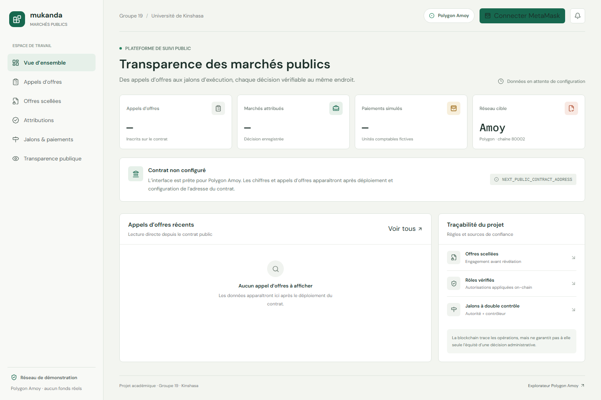
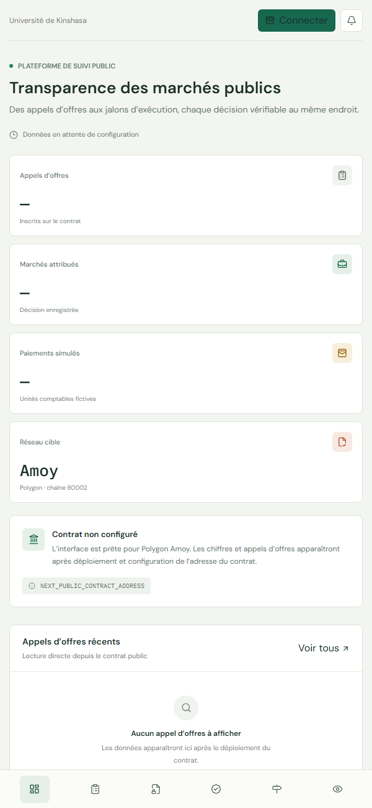

# Mukanda — Transparence des marchés publics

Projet académique de Blockchain et Cryptomonnaies, Groupe 19, Université de Kinshasa.

## Équipe

- KAZADI KABUYA AUGUSTIN
- LUABEYA MUKENDI BARNABE
- MBUYI MUTUNGILAYI BENJAMIN

## Objectif

Prototype de DApp pour publier des appels d’offres, engager puis révéler des offres, enregistrer une décision d’attribution et suivre des jalons d’exécution. Le contrat applique les rôles et les échéances ; il ne décide pas si une attribution est administrativement juste.

**État vérifié dans ce dépôt :** contrat avec rôles séparés et inscription entreprise déployé sur Polygon Amoy ; dix tests Hardhat, build Next.js, typecheck et lint passent. Le portail public local est configuré pour ce contrat. Le dépôt GitHub privé est créé, mais les sources applicatives restent à pousser et le frontend Vercel n’est pas encore publié.

## Fonctionnalités

- Rôles `DEFAULT_ADMIN_ROLE`, `AUTHORITY_ROLE`, `CONTROLLER_ROLE` et `COMPANY_ROLE` contrôlés par OpenZeppelin AccessControl.
- Accueil orienté profils : consultation publique, participation entreprise, opérations autorité/contrôleur et administration selon les rôles relus sur chaîne.
- À la première connexion avec un portefeuille sans rôle, l’entreprise confirme une transaction d’auto-inscription qui attribue `COMPANY_ROLE`. Les rôles privilégiés ne peuvent pas devenir entreprise ; une offre par adresse et par marché.
- L’administrateur peut attribuer/révoquer Entreprise, Autorité et Contrôleur depuis l’interface ; les rôles sont mutuellement exclusifs et la gestion du rôle administrateur reste hors UI.
- Publication d’un marché avec calendrier, budget indicatif et empreinte de dossier IPFS.
- Engagement commit-reveal lié à l’identifiant du marché, au portefeuille, au montant, à l’empreinte de l’offre et à un secret aléatoire.
- Sauvegarde locale de révélation chiffrée avec AES-GCM et clé dérivée par PBKDF2-SHA-256.
- Attribution après la clôture de révélation, avec titulaire et référence de décision.
- Jalons plafonnés au montant attribué et libérés dans le registre seulement après deux validations distinctes.
- Dashboard français responsive, MetaMask, Polygon Amoy, consultation du contrat et liens vers l’explorateur.
- Téléversement Pinata côté serveur (PDF/DOCX/JPG/PNG jusqu’à 4 Mo) : le JWT n’est jamais exposé au navigateur.

Les paiements sont explicitement simulés : le contrat ne transfère ni POL ni jeton ERC-20. The Graph n’est pas intégré dans cette version ; la lecture publique repose sur l’ABI et le RPC Amoy.

## Architecture

- `contracts/` : contrat Solidity et règles de transition.
- `test/` : tests Hardhat/Mocha/Ethers.
- `scripts/` : déploiement Polygon Amoy et génération du PowerPoint.
- `src/app/` : App Router Next.js, dashboard et endpoint Pinata.
- `src/components/` : formulaires d’opérations DApp.
- `src/lib/` : ABI, paramètres réseau, engagements et sauvegardes chiffrées.
- `docs/` : rapport technique et présentation PowerPoint.
- `deployments/polygonAmoy.json` : manifeste du déploiement Amoy confirmé, avec adresse, transaction, bloc, gas et rôles.

Déploiement courant : [contrat sur PolygonScan Amoy](https://amoy.polygonscan.com/address/0x15Ba0b28c6DAc1d865F891c083A61d3E6808b982), bloc `51909186`, [transaction de création](https://amoy.polygonscan.com/tx/0x369ba97ca0d64f1ea2dbe973636a118d02f66df3603bb1e8dbbfb491363fd6b2). Le reçu indique `3,411,584` gas, soit environ `0.10234752 POL` de test. Le code source n’est pas encore vérifié sur Polygonscan.

## Captures d’écran

Vue desktop :



Vue mobile :



Sur la chaîne : données de marché utiles à la traçabilité, CID/hash du dossier, engagements, révélations, décision, jalons, validations et événements. Hors chaîne : fichiers IPFS, texte confidentiel avant révélation et sauvegarde chiffrée du soumissionnaire. Un document public sur IPFS n’est pas confidentiel ; ne pas y envoyer de données personnelles ou de documents secrets non chiffrés.

## Prérequis

- Node.js 22 ou plus récent et npm.
- MetaMask pour soumettre des transactions.
- POL de test sur Polygon Amoy pour payer le gas.
- Un compte Pinata et un JWT pour épingler des fichiers. Les autres vues restent utilisables sans Pinata.
- RPC Amoy facultatif ; le RPC public est utilisé comme valeur de secours pour la démonstration.

Versions installées lors de la préparation : Next.js 16.4.4, React 19.3.0, TypeScript 5.9.3, Hardhat 3.21.2, Solidity 0.8.28, OpenZeppelin Contracts 5.6.1, ethers 6.17.0, toolbox Mocha/Ethers 4.0.0 et Tailwind CSS 4.3.4. `package-lock.json` fixe l’arbre npm réellement testé.

## Installation locale

```powershell
npm ci
Copy-Item .env.example .env
npm run dev
```

Ouvre `http://localhost:3000`. La configuration fournie pointe vers le contrat de démonstration ci-dessus. Pour un nouveau déploiement, remplace l’adresse et le bloc dans les variables `NEXT_PUBLIC_*`.

## Configuration

Copie `.env.example` vers `.env`, puis renseigne uniquement les valeurs dont tu disposes :

| Variable | Utilisation | Secret ? |
| --- | --- | --- |
| `AMOY_RPC_URL` | RPC utilisé par Hardhat | Peut être privé selon le fournisseur |
| `DEPLOYER_PRIVATE_KEY` | Portefeuille de test utilisé pour le déploiement | **Oui, ne jamais publier** |
| `AUTHORITY_ADDRESS` | Portefeuille autorité | Non |
| `CONTROLLER_ADDRESS` | Portefeuille contrôleur, distinct de l’autorité | Non |
| `PINATA_JWT` | Téléversement de dossiers via le serveur Next.js | **Oui, ne jamais publier** |
| `NEXT_PUBLIC_AMOY_RPC_URL` | RPC lu par le navigateur | Public |
| `NEXT_PUBLIC_CONTRACT_ADDRESS` | Contrat déployé sur Amoy | Public |
| `NEXT_PUBLIC_DEPLOYMENT_BLOCK` | Bloc de déploiement, réservé à l’indexation d’événements | Public |

Le fichier `.env` est ignoré par Git. N’utilise qu’un portefeuille dédié et vide de fonds réels. Les variables `NEXT_PUBLIC_*` sont incluses dans le bundle du navigateur et ne doivent contenir aucun secret.

## Compilation et tests

```powershell
npm run contracts:compile
npm run contracts:test
npm run contracts:analyze
npm run typecheck
npm run lint
npm run build
npm run docs:presentation
```

La génération de la présentation écrit `docs/presentation.pptx` (15 diapositives). Les neuf tests couvrent la séparation des rôles Entreprise/Autorité/Contrôleur, les engagements, les fenêtres, les révélations, les montants invalides, l’attribution et les jalons.

## Polygon Amoy

1. Ajoute Polygon Amoy dans MetaMask : chain ID `80002` (`0x13882`), devise native `POL`, explorateur `https://amoy.polygonscan.com`.
2. Obtiens des jetons de test via le [faucet officiel Polygon](https://faucet.polygon.technology/) et vérifie que le réseau sélectionné est Amoy.
3. Renseigne `AMOY_RPC_URL`, `DEPLOYER_PRIVATE_KEY`, `AUTHORITY_ADDRESS` et `CONTROLLER_ADDRESS` dans `.env`. Les deux rôles doivent utiliser des adresses distinctes.
4. Lance `npm run contracts:deploy:amoy`. Le script vérifie le chain ID, déploie puis attend la confirmation avant d’écrire `deployments/polygonAmoy.json`.
5. Vérifie manuellement le contrat à l’adresse indiquée dans ce fichier et copie cette adresse vers `NEXT_PUBLIC_CONTRACT_ADDRESS`.
6. Configure `PINATA_JWT` côté serveur, puis lance `npm run build` et `npm start` pour vérifier la version de production.
7. Pour publier le frontend, suis le [guide de déploiement Vercel](docs/deploiement-vercel.md). Le contrat reste sur Polygon Amoy ; son déploiement Hardhat est une opération distincte.

Le contrat, son adresse, le hash et le bloc ci-dessus ont été déployés et vérifiés via RPC Amoy. L’inscription entreprise a été simulée avec succès et les rôles initiaux ont été relus sur chaîne. Le dépôt GitHub, l’URL Vercel et la vérification du code source sur Polygonscan restent à faire. La clé du portefeuille de démonstration a été exposée pendant la préparation ; elle ne doit servir qu’à ce prototype testnet et jamais avec des fonds réels.

## Analyse de sécurité et limites

- Aucun mécanisme de transfert n’existe dans ce prototype ; la réentrance liée aux transferts ne s’applique donc pas aux opérations actuelles.
- Les engagements sont publics : commit-reveal masque le préimage jusqu’à la révélation, pas l’existence ni l’adresse du soumissionnaire.
- Une entreprise peut ne jamais révéler son offre ; le contrat ne peut pas forcer une révélation.
- Les rôles d’autorité et de contrôleur doivent appartenir à des comptes distincts pour libérer un jalon.
- La limite d’upload en mémoire est adaptée à une démonstration mono-instance ; en production, il faut un rate limiter distribué, authentification/anti-abus et analyse des fichiers.
- Les alertes `npm audit` restantes concernent les dépendances de développement. `npm audit --omit=dev` ne rapporte aucune vulnérabilité runtime dans l’état vérifié. N’applique pas `npm audit fix --force` sans migration et revalidation.
- Aucun audit indépendant n’a été réalisé. Ne considère pas le contrat comme sécurisé au seul motif que les tests passent.
- La clé du compte déployeur utilisée pour ce déploiement testnet a été exposée pendant les échanges ; ne la réutilise jamais pour des fonds réels ou un autre projet.
- L’indexation The Graph, les paiements réels, la gouvernance multi-signature et le traitement complet des appels d’offres sont hors du MVP.

Voir [le rapport technique](docs/rapport-technique.md) pour le modèle de menace, les tests, les coûts en gas et les limites détaillées.
